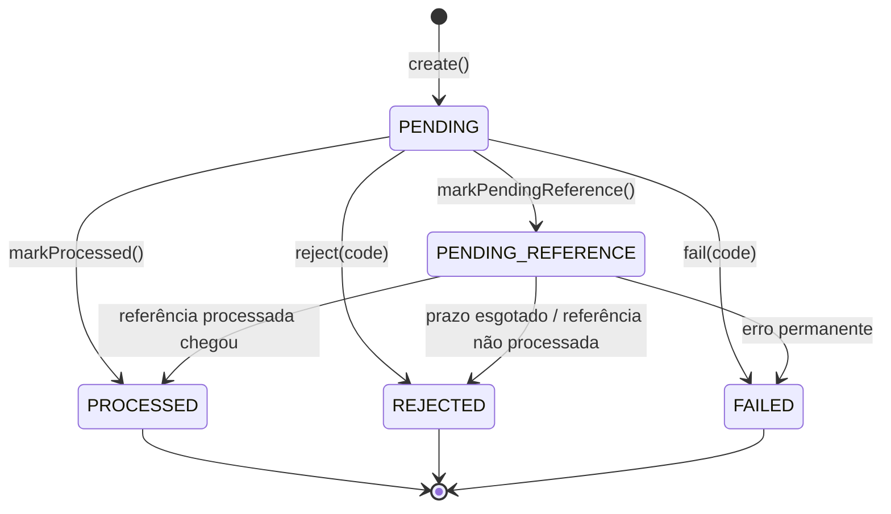

# Data Model: Distributed Wagering Processor

Fase 1 do `/speckit-plan`. Descreve o domínio (classes) e o schema (tabelas, constraints,
índices, triggers). Decisões de fundo em [research.md](./research.md).

---

## 1. Domínio

### 1.1 Money (value object)

| Campo | Tipo | Regra |
|---|---|---|
| `minor` | `bigint` (privado) | centavos, `>= 0n` em contratos de entrada |
| `currency` | `string` | ISO-4217, 3 letras maiúsculas |

- Factories: `from({ amount, currency })` valida o formato (R3); `zero(currency)`;
  `fromMinor(minor, currency)` é interno, para a reidratação e a aritmética.
- Operações: `add`, `subtract`, `negate`, `isZero`, `isPositive`, `isNegative`, `isLessThan`,
  `equals`. Toda operação entre moedas diferentes lança `CurrencyMismatchError`. Toda operação
  retorna uma nova instância.
- `toJSON()` → `{ amount: "25.00", currency: "BRL" }`; `toString()` → `"25.00 BRL"`.

### 1.2 Wallet (aggregate root)

| Campo | Regra |
|---|---|
| `id`, `playerId`, `currency`, `createdAt` | imutáveis |
| `balance: Money` | nunca negativo; moeda = `currency` |
| `version: number` | começa em 1; `+1` somente quando o saldo muda |
| `updatedAt` | atualizado quando o saldo muda |

- `open({ id, playerId, initialBalance })` → `{ wallet, openingEntry? }`. Saldo `> 0` gera a
  transação interna `OPENING` e o lançamento `CREDIT`.
- `debit(money, transactionId, at)` → `WalletLedgerEntry`; lança `InsufficientFundsError` se o
  saldo não cobrir o valor.
- `credit(money, transactionId, at)` → `WalletLedgerEntry`.
- O lançamento é criado **pelo próprio agregado**, com `balanceBefore`/`balanceAfter` do saldo
  que ele acabou de alterar: saldo e ledger não têm como divergir.

### 1.3 WagerTransaction

Campos conforme o README §6.3, mais:

| Campo extra | Para quê |
|---|---|
| `resultBalance?: Money`, `resultWalletVersion?: number` | resposta exata do replay (FR-026) |
| `attempts`, `nextAttemptAt?`, `expiresAt?` | reprocessamento de `PENDING_REFERENCE` (FR-022) |

**Kinds e regras** (README §7 + decisões da spec):

| Kind | Efeito | Referência | Tipos de referência aceitos |
|---|---|---|---|
| `OPENING` | crédito | não | só interno |
| `BET` | débito | não | — |
| `WIN` | crédito | opcional | `BET` |
| `LOSS` | nenhum | opcional | `BET` |
| `REFUND` | crédito | obrigatória | `BET` |
| `ROLLBACK` | inverso da referência | obrigatória | `BET`, `WIN`, `REFUND` |

`ledgerDirectionFor(reference)` define a direção do lançamento de um `ROLLBACK`:

| Referência do ROLLBACK | Direção |
|---|---|
| `BET` (era débito) | `CREDIT` |
| `WIN` (era crédito) | `DEBIT` |
| `REFUND` (era crédito) | `DEBIT` |

**Máquina de estados** (FR-021). O status `PENDING` existe só em memória, durante a decisão;
nunca é persistido, porque a decisão acontece na mesma transação da criação.



Transição a partir de estado terminal → `InvalidTransactionStateError` (erro de programação).

**Ordem de validação no caso de uso** (o primeiro que falha define o `failureCode`):

1. Formato do payload → 400 (não persiste).
2. `kind = OPENING` vindo de fora → 400 `OPENING_NOT_ALLOWED`.
3. Identidade do chamador ≠ `providerId` → 403 `PROVIDER_MISMATCH`, **sem persistir**. Se a
   recusa fosse gravada, o `provider-a` poderia "envenenar" a chave `provider-b:tx-1`: quando o
   `provider-b` enviasse a operação legítima, receberia o replay da rejeição.
4. Idempotência: replay / conflito de chave / conflito de id externo (R5).
5. Wallet inexistente → 422 `WALLET_NOT_FOUND`; `playerId` ≠ dono → `WALLET_PLAYER_MISMATCH`;
   moeda ≠ → `CURRENCY_MISMATCH`.
6. Referência (quando houver): ausente → `PENDING_REFERENCE`; outro provider, player, wallet,
   moeda ou rodada → `REFERENCE_MISMATCH`; tipo inválido → `INVALID_REFERENCE_KIND`; terminal não
   processada → `REFERENCE_NOT_PROCESSED`; já revertida → `REFERENCE_ALREADY_REVERSED` (para
   reversões) ou `REFERENCE_REVERSED` (para WIN/LOSS); valor diferente (reversões) →
   `REVERSAL_AMOUNT_MISMATCH`.
7. Saldo: BET sem saldo → `INSUFFICIENT_FUNDS`; reversão que negativaria →
   `REVERSAL_INSUFFICIENT_FUNDS`.

> Uma `wallet` inexistente não tem linha para travar. Nesse caso a rejeição é gravada sem lock;
> o `UNIQUE (idempotency_key)` resolve duplicatas concorrentes.
> A `wallet_id` dessas linhas rejeitadas não tem FK obrigatória (ver §2.2).

### 1.4 WalletLedgerEntry

Imutável: sem setters, sem métodos de transição. `create()` valida
`balanceBefore ± money == balanceAfter` e moedas iguais; `isBalanced()` expõe a checagem.

### 1.5 InboxMessage, OutboxMessage, IntegrationEvent

Conforme o README §6.5 e §11. `OutboxMessage.scheduleRetry(now)`:
`nextAttemptAt = now + min(60 s, 1 s × 2^attempts) ± 20 %`.

Eventos (classe abstrata `IntegrationEvent<T>`, uma subclasse por tipo, `version = 1`):

| Evento | Quando | `aggregateId` |
|---|---|---|
| `WagerTransactionProcessed` | qualquer transação aplicada, inclusive `LOSS` e `OPENING` | `transactionId` |
| `WagerTransactionRejected` | rejeição de negócio (inclusive por prazo) | `transactionId` |
| `WagerTransactionFailed` | transação `FAILED` | `transactionId` |
| `WagerTransactionPendingReference` | entrou em `PENDING_REFERENCE` | `transactionId` |
| `WalletBalanceChanged` | somente quando o saldo muda | `walletId` |

`correlationId` vem da requisição ou mensagem; `causationId` = `messageId` da fila ou
`transactionId` que causou o evento.

---

## 2. Schema (PostgreSQL)

Convenções: `snake_case`, `TIMESTAMPTZ`, dinheiro em `NUMERIC(19,2)` + `CHAR(3)`.

### 2.1 `wallet`

| Coluna | Tipo | Restrição |
|---|---|---|
| `id` | `UUID` | PK |
| `player_id` | `UUID` | NOT NULL |
| `currency` | `CHAR(3)` | NOT NULL, `CHECK (currency ~ '^[A-Z]{3}$')` |
| `balance` | `NUMERIC(19,2)` | NOT NULL, `CHECK (balance >= 0)` |
| `version` | `INTEGER` | NOT NULL, `CHECK (version >= 1)` |
| `created_at`, `updated_at` | `TIMESTAMPTZ` | NOT NULL |

- `UNIQUE (player_id, currency)`.

### 2.2 `wager_transaction`

| Coluna | Tipo | Restrição |
|---|---|---|
| `id` | `UUID` | PK |
| `provider_id` | `TEXT` | NOT NULL |
| `external_transaction_id` | `TEXT` | NOT NULL |
| `idempotency_key` | `TEXT` | NOT NULL |
| `payload_hash` | `CHAR(64)` | NOT NULL |
| `wallet_id` | `UUID` | NOT NULL (sem FK: pode referenciar wallet inexistente numa rejeição) |
| `player_id` | `UUID` | NOT NULL |
| `round_id`, `game_id` | `TEXT` | NOT NULL (`OPENING` usa valores internos fixos) |
| `kind` | `TEXT` | `CHECK (kind IN ('OPENING','BET','WIN','LOSS','REFUND','ROLLBACK'))` |
| `amount` | `NUMERIC(19,2)` | `CHECK (amount > 0 OR (kind = 'LOSS' AND amount >= 0))` |
| `currency` | `CHAR(3)` | NOT NULL |
| `reference_external_transaction_id` | `TEXT` | NULL |
| `reference_transaction_id` | `UUID` | NULL, FK → `wager_transaction(id)` |
| `status` | `TEXT` | `CHECK (status IN ('PENDING_REFERENCE','PROCESSED','REJECTED','FAILED'))` |
| `failure_code` | `TEXT` | NULL |
| `result_balance` | `NUMERIC(19,2)` | NULL |
| `result_wallet_version` | `INTEGER` | NULL |
| `attempts` | `INTEGER` | NOT NULL DEFAULT 0 |
| `next_attempt_at`, `expires_at` | `TIMESTAMPTZ` | NULL |
| `created_at`, `updated_at` | `TIMESTAMPTZ` | NOT NULL |
| `processed_at` | `TIMESTAMPTZ` | NULL |

Constraints e índices:

- `UNIQUE (idempotency_key)`.
- `UNIQUE (provider_id, external_transaction_id)` (FR-028a; também resolve referências).
- `CHECK (kind NOT IN ('REFUND','ROLLBACK') OR reference_external_transaction_id IS NOT NULL)`.
- `CHECK ((status IN ('REJECTED','FAILED')) = (failure_code IS NOT NULL))`.
- `CHECK ((status = 'PROCESSED') = (processed_at IS NOT NULL))`.
- `CHECK (status <> 'PENDING_REFERENCE' OR (next_attempt_at IS NOT NULL AND expires_at IS NOT NULL))`.
- Reversão única por transação (FR-049):
  `CREATE UNIQUE INDEX ux_reversal_once ON wager_transaction (reference_transaction_id)
   WHERE kind IN ('REFUND','ROLLBACK') AND status = 'PROCESSED';`
- Fila de pendentes:
  `CREATE INDEX ix_pending_due ON wager_transaction (next_attempt_at) WHERE status = 'PENDING_REFERENCE';`
- Resolução de pendentes quando a referência chega:
  `CREATE INDEX ix_pending_ref ON wager_transaction (provider_id, reference_external_transaction_id) WHERE status = 'PENDING_REFERENCE';`
- Trigger `trg_wager_transaction_guard` (`BEFORE UPDATE`):
  - se `OLD.status IN ('PROCESSED','REJECTED','FAILED')` → `RAISE EXCEPTION`;
  - se algum campo de negócio mudou (`provider_id`, `external_transaction_id`, `idempotency_key`,
    `payload_hash`, `wallet_id`, `player_id`, `round_id`, `game_id`, `kind`, `amount`,
    `currency`, `reference_external_transaction_id`) → `RAISE EXCEPTION`.
- Trigger `BEFORE DELETE` → `RAISE EXCEPTION` (transações são auditoria).

### 2.3 `wallet_ledger_entry`

| Coluna | Tipo | Restrição |
|---|---|---|
| `id` | `UUID` | PK |
| `seq` | `BIGINT` | `GENERATED ALWAYS AS IDENTITY`, UNIQUE |
| `wallet_id` | `UUID` | NOT NULL, FK → `wallet(id)` |
| `transaction_id` | `UUID` | NOT NULL, FK → `wager_transaction(id)` |
| `direction` | `TEXT` | `CHECK (direction IN ('DEBIT','CREDIT'))` |
| `amount` | `NUMERIC(19,2)` | `CHECK (amount > 0)` |
| `currency` | `CHAR(3)` | NOT NULL |
| `balance_before`, `balance_after` | `NUMERIC(19,2)` | NOT NULL, `CHECK (balance_after >= 0)` |
| `created_at` | `TIMESTAMPTZ` | NOT NULL |

- `UNIQUE (transaction_id, wallet_id)` (no máximo um lançamento por transação e wallet).
- `CHECK ((direction = 'CREDIT' AND balance_after = balance_before + amount) OR
          (direction = 'DEBIT'  AND balance_after = balance_before - amount))`.
- `INDEX (wallet_id, seq)` para o extrato e a reconciliação.
- Triggers `BEFORE UPDATE`, `BEFORE DELETE` e `BEFORE TRUNCATE` → `RAISE EXCEPTION`.

### 2.4 `inbox_message`

| Coluna | Tipo | Restrição |
|---|---|---|
| `consumer_name` | `TEXT` | PK (composta) |
| `message_id` | `TEXT` | PK (composta) |
| `payload_hash` | `CHAR(64)` | NOT NULL |
| `received_at` | `TIMESTAMPTZ` | NOT NULL |
| `processed_at` | `TIMESTAMPTZ` | NULL |

### 2.5 `outbox_message`

| Coluna | Tipo | Restrição |
|---|---|---|
| `id` | `UUID` | PK (= `eventId`) |
| `aggregate_id` | `UUID` | NOT NULL |
| `event_type` | `TEXT` | NOT NULL |
| `event_version` | `INTEGER` | NOT NULL |
| `payload` | `JSONB` | NOT NULL (envelope de `toJSON()`) |
| `occurred_at` | `TIMESTAMPTZ` | NOT NULL |
| `attempts` | `INTEGER` | NOT NULL DEFAULT 0 |
| `next_attempt_at` | `TIMESTAMPTZ` | NOT NULL |
| `published_at` | `TIMESTAMPTZ` | NULL |
| `last_error` | `TEXT` | NULL (sem dados sensíveis) |

- `CREATE INDEX ix_outbox_due ON outbox_message (next_attempt_at) WHERE published_at IS NULL;`

---

## 3. Reconciliação

```sql
SELECT w.balance                                   AS stored,
       COALESCE(SUM(CASE l.direction WHEN 'CREDIT' THEN l.amount
                                     ELSE -l.amount END), 0) AS calculated,
       COUNT(l.id)                                 AS checked_entries
FROM wallet w LEFT JOIN wallet_ledger_entry l ON l.wallet_id = w.id
WHERE w.id = $1
GROUP BY w.balance;
```

Lida em uma única transação `REPEATABLE READ` (foto consistente). Também verifica que o
`balance_after` do último lançamento é igual ao saldo guardado. Divergência → log `error`,
`reconciliation_divergences_total + 1` e `consistent: false`. Nada é corrigido.

## 4. Atomicidade por caso de uso

| Caso de uso | Na mesma transação SQL |
|---|---|
| Abrir wallet | `wallet` + (`wager_transaction` OPENING + `ledger` + `outbox`) |
| Submeter (HTTP) | lock `wallet` + `wager_transaction` + (`ledger` + update `wallet`) + `outbox` |
| Submeter (SQS) | idem + `inbox_message` |
| Reprocessar pendente | lock `wallet` + update `wager_transaction` + (`ledger` + `wallet`) + `outbox` |
| Publicar outbox | lote `outbox_message` (update `published_at`/`attempts`) |
